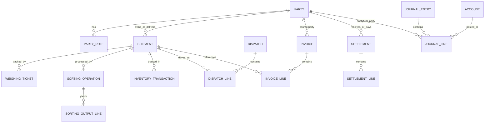

# مدل داده و قراردادهای ذخیره‌سازی

وضعیت: طرح منطقی اولیه؛ پیش از migration واقعی باید با سناریوهای قطعی و نسخه پایگاه داده تطبیق داده شود.

## 1. قراردادهای عمومی

- کلید اصلی داخلی: ترجیحاً عدد/UUID پایدار؛ تصمیم نهایی در معماری ثبت شود.
- کد نمایشی سند: مستقل از کلید اصلی و قابل جست‌وجو.
- تاریخ عملیاتی و زمان ایجاد رکورد دو فیلد متفاوت‌اند.
- تمام جدول‌های عملیاتی باید زمان ایجاد، ایجادکننده و وضعیت داشته باشند، در صورت تناسب با موجودیت.
- سند قطعی پاک نمی‌شود؛ اصلاح آن با سند معکوس/اصلاحی.
- تمام مبالغ با نوع داده دقیق (در .NET معمولاً `decimal`) در منطق برنامه محاسبه شوند؛ نوع ذخیره‌سازی در SQLite با قرارداد مشخص و آزمون تبدیل تعیین شود.
- همه وزن‌ها واحد پایه روشن داشته باشند؛ مقدار و کد واحد باید در سند/تعریف قابل کشف باشد.
- شناسه منبع سند برای جلوگیری از ثبت تکراری رویدادهای مالی/انبار استفاده شود.
- migrationها به‌صورت نسخه‌دار، تراکنشی و قابل آزمون باشند.

## 2. نمودار منطقی روابط

این نمودار مفهومی است؛ cardinality، وضعیت‌ها و روابط nullable باید در طرح فیزیکی نهایی تعیین شوند.

## 3. موجودیت‌های اصلی و قیود

### 3.1 Party

فیلدها: `PartyId`, `PartyCode`, `DisplayName`, `LegalName`, `Phone`, `Address`, `Notes`, `IsActive`, `CreatedAt`, `CreatedBy`, `UpdatedAt`, `UpdatedBy`.

قیود:
- `PartyCode` یکتا باشد.
- غیرفعال‌کردن شخصی که گردش مالی دارد به معنی حذف اسناد گذشته نیست.
- تشخیص تشابه نام/تلفن راهنمای کاربر است، نه ادغام خودکار.

### 3.2 PartyRole

فیلدها: `PartyRoleId`, `PartyId`, `RoleType`, `ValidFrom`, `ValidTo`, `IsActive`.

یک شخص می‌تواند بیش از یک نقش فعال داشته باشد.

### 3.3 Product / Grade / PackagingType

محصول پایه، درجه محصول و بسته‌بندی از هم جدا باشند. «پرتقال درجه یک در سبد ۱۰ کیلویی» نباید الزاماً یک SKU غیرقابل تفکیک در تمام جداول باشد.

فیلدهای پیشنهادی:
- `Product`: کد، نام، دسته، واحد پایه، فعال/غیرفعال.
- `Grade`: کد، نام، ترتیب نمایش.
- `PackagingType`: کد، نام، وزن ظرف مرجع، واحد شمارش، فعال/غیرفعال.
- `ProductPackagingRule`: در صورت نیاز، قواعد مجاز محصول/بسته‌بندی با تاریخ اثر.

### 3.4 Shipment

فیلدها: `ShipmentId`, `ShipmentCode`, `OwnerPartyId`, `DeliveringPartyId`, `ProductId` یا رابطه ردیفی در صورت چندمحصولی‌بودن، `ReceivedAt`, `ReceivedWeight`, `CurrentState`, `Notes`.

اگر محموله ورودی در ابتدا چند نوع محصول دارد، مدل نباید با اجبار `ProductId` یگانه اطلاعات واقعی را تخریب کند. در این حالت `ShipmentLines` لازم است.

### 3.5 WeighingTicket

فیلدهای مهم: شماره، نوع ورود/خروج، خودرو، راننده، زمان توزین، وزن ناخالص، وزن خالی، وزن خالص محاسباتی، وزن خالص تأییدشده (اگر تفاوت سیاستی وجود دارد)، اپراتور و وضعیت.

قیدها:
- مقادیر وزن نامنفی باشند.
- اگر gross کمتر از tare است، سند عادی قطعی نشود.
- شماره نمایشی یکتا در محدوده سری/سال خود باشد.
- در صورت نیاز به چند محموله، ارتباط از جدول واسط انجام شود.

### 3.6 SortingOperation / SortingOutputLine

عملیات ورودی را مصرف می‌کند و چند خروجی تولید می‌کند. هر خروجی محصول، درجه، وزن، نوع بسته‌بندی و تعداد بسته را مشخص می‌کند. افت، ضایعات و اختلاف اندازه‌گیری باید به‌صورت دسته‌های مجزا ثبت شوند.

### 3.7 InventoryTransaction

جدول گردش انبار مرجع رویدادهای موجودی است. فیلدهای پیشنهادی:
- کلید، زمان رویداد، نوع حرکت، محصول/درجه، محموله، مکان، بسته‌بندی، مقدار، واحد، سند منبع، ردیف منبع، وضعیت قطعی، عامل ثبت.

الزام: برای هر `SourceDocumentType + SourceDocumentId + SourceLineId + TransactionPurpose` قاعده یکتایی/Idempotency تعریف شود تا اجرای دوباره یک فرمان رویداد را دوباره ثبت نکند.

### 3.8 Invoice / InvoiceLine

سربرگ شامل شخص، نوع فاکتور، تاریخ سند، شماره کاغذی، وضعیت، جمع قبل از تخفیف، تخفیف، اضافات و جمع نهایی باشد. ردیف شامل محصول، وزن/تعداد، واحد، قیمت واحد، مبلغ، تخفیف ردیف و ارجاع اختیاری به محموله باشد.

جمع سربرگ باید از ردیف‌ها و قواعد مشخص محاسبه شود؛ ویرایش دستی جمع نهایی بدون سند تعدیل کنترل‌شده مجاز نیست.

### 3.9 Expense / ExpenseAllocation

هزینه واقعی را از تخصیص هزینه به محموله/مرکز هزینه جدا کنید. یک هزینه ممکن است بین چند محموله تخصیص یابد؛ جمع تخصیص‌ها باید طبق سیاست با مبلغ اصلی تطبیق داشته باشد.

فیلدهای پیشنهادشده در Expense: دسته، مبلغ، تاریخ، شخص، سند منبع، روش پرداخت/وضعیت پرداخت، وضعیت تأیید، مالک هزینه، قابل‌مطالبه‌بودن.

فیلدهای ExpenseAllocation: شناسه هزینه، مقصد تخصیص، مبلغ/درصد تخصیص، روش تخصیص.

### 3.10 Settlement / SettlementLine

Settlement سربرگ محاسبه و وضعیت را نگه می‌دارد. SettlementLine هر محصول/درجه/بسته را با وزن ارسالی، وزن اعلامی، قیمت و مبانی محاسبه نگه می‌دارد.

`CalculationMode` باید مقدار کنترل‌شده داشته باشد؛ مثلاً `NetAmountInput` یا `NetRateInput`. ذخیره مقدار ورودی و خروجی ضروری است تا بعداً معلوم باشد کاربر چه مقداری را وارد کرده است.

### 3.11 JournalEntry / JournalLine

- سند دارای شماره، تاریخ، توضیح، وضعیت، منبع سند و عامل ایجاد است.
- ردیف دارای حساب، شخص تفصیلی اختیاری، بدهکار، بستانکار و توضیح است.
- در سند قطعی: تعداد ردیف‌ها کافی، مبالغ غیرمنفی و جمع بدهکار برابر جمع بستانکار باشد.
- در یک ردیف هم‌زمان بدهکار و بستانکار مثبت ثبت نشود.
- ارز و نرخ تبدیل، اگر چندارزی لازم شد، نیازمند تصمیم مستقل است.

### 3.12 AuditLog

از ثبت تغییر در AuditLog باید برای عملیات حساس استفاده شود. دسترسی حذف آن محدود شود. نباید ادعای «ضد دستکاری مطلق» مطرح شود؛ برای ممیزی قوی‌تر می‌توان hash chaining/امضای دوره‌ای را در نسخه بعدی ارزیابی کرد.

## 4. داده‌های مشتق‌شده

مواردی که بهتر است از گردش اسناد محاسبه شوند یا با مکانیزم بازسازی معتبر نگهداری شوند:

- موجودی جاری
- موجودی رزروشده
- موجودی قابل تخصیص
- مانده حساب اشخاص
- جمع بدهکار/بستانکار دوره
- ارزش موجودی
- صافی نهایی قطعی

اگر برای کارایی snapshot یا cache ذخیره شود، باید امکان بازسازی از اسناد منبع و بررسی اختلاف وجود داشته باشد.

## 5. شاخص‌های پایگاه داده

شاخص روی فیلدهای جست‌وجو و پیوند پرکاربرد ارزیابی شود:
- شماره سند
- کد شخص
- نام نرمال‌شده شخص (در صورت نیاز)
- تاریخ عملیاتی
- شماره محموله
- شناسه سند منبع
- ترکیب وضعیت + تاریخ برای صف‌های کاری

شاخص‌گذاری فقط پس از مشاهده queryهای واقعی نهایی شود.

## 6. سیاست حذف

- داده پایه بدون استفاده مالی ممکن است با مجوز حذف شود.
- شخص/محصول دارای تاریخچه به‌طور معمول غیرفعال می‌شود.
- پیش‌نویس ممکن است طبق سیاست پاک یا لغو شود.
- سند قطعی مالی یا انبار حذف مستقیم نمی‌شود.
- فایل پیوست حذف‌شده باید با سیاست retention و سابقه خود مدیریت شود.

## 7. Migration

هر migration باید:
1. شماره نسخه داشته باشد؛
2. ترجیحاً تراکنشی باشد؛
3. روی دیتابیس قبلی و دیتابیس خالی آزمایش شود؛
4. در صورت شکست، داده نیمه‌تغییر یافته باقی نگذارد؛
5. در یادداشت انتشار شرح داده شود؛
6. پیش از اجرا نسخه پشتیبان معتبر داشته باشد.
